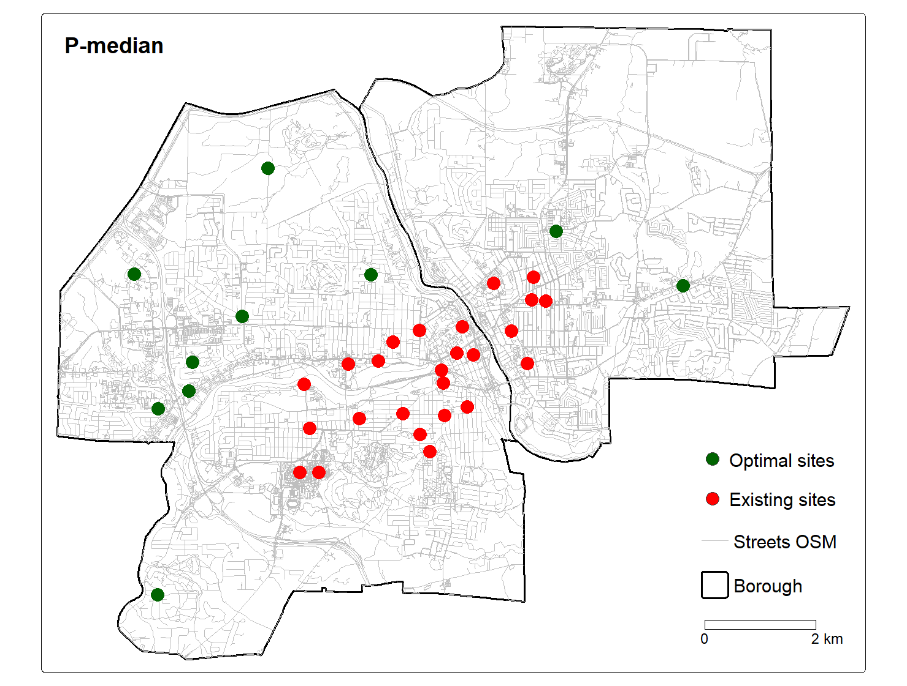

# Application of the p-median problem

This vignette describes how to use the p-median function in `localalloc`
that can help to maximize average accessibility across the network. It
will show a step-by-step example with all arguments.

## Application of the p-median model with the addition of Bixi stations

### Installation

Make sure first you have install the `localalloc` package.

``` r

pak::pkg_install("sfoucher/localalloc")
```

    ## ℹ Loading metadata database

    ## ✔ Loading metadata database ... done

    ## 

    ## 

    ## → Package library at /home/runner/work/_temp/Library.

    ## ✔ All system requirements are already installed.

    ## 

    ## ℹ No downloads are needed

    ## ℹ Installing system requirements

    ## ℹ Executing `sudo sh -c apt-get -y update`

    ## Get:1 file:/etc/apt/apt-mirrors.txt Mirrorlist [144 B]

    ## Hit:6 https://packages.microsoft.com/ubuntu/26.04/prod resolute InRelease
    ## Hit:2 http://azure.archive.ubuntu.com/ubuntu resolute InRelease

    ## Hit:3 http://azure.archive.ubuntu.com/ubuntu resolute-updates InRelease

    ## Hit:4 http://azure.archive.ubuntu.com/ubuntu resolute-backports InRelease
    ## Hit:5 http://azure.archive.ubuntu.com/ubuntu resolute-security InRelease

    ## Reading package lists...

    ## ℹ Executing `sudo sh -c apt-get -y install cmake pkg-config libglpk-dev libabsl-dev libssl-dev libgdal-dev gdal-bin libgeos-dev libproj-dev libsqlite3-dev libudunits2-dev`

    ## Reading package lists...

    ## Building dependency tree...

    ## Reading state information...

    ## cmake is already the newest version (4.2.3-2ubuntu2).
    ## pkg-config is already the newest version (2.5.1-4).
    ## libglpk-dev is already the newest version (5.0-2build1).
    ## libabsl-dev is already the newest version (20260107.0-4).
    ## libssl-dev is already the newest version (3.5.5-1ubuntu3.7).
    ## libgdal-dev is already the newest version (3.12.2+dfsg-1build2).
    ## gdal-bin is already the newest version (3.12.2+dfsg-1build2).
    ## libgeos-dev is already the newest version (3.14.1-2).
    ## libproj-dev is already the newest version (9.7.1-1).
    ## libsqlite3-dev is already the newest version (3.46.1-9ubuntu0.3).
    ## libudunits2-dev is already the newest version (2.2.28-8).
    ## Solving dependencies...

    ## 0 upgraded, 0 newly installed, 0 to remove and 25 not upgraded.

    ## ✔ 1 pkg + 18 deps: kept 19 [5.1s]

``` r

library(localalloc)
```

### Bixi dataset

As an example, we read the Bixi dataset available in the `localalloc`
package:

- bixi_candidates : Indicate possible locations for Bixi stations (sf
  POINT)

&nbsp;

    ## Linking to GEOS 3.14.1, GDAL 3.12.2, PROJ 9.7.1; sf_use_s2() is TRUE

    ## Simple feature collection with 6 features and 3 fields
    ## Geometry type: POINT
    ## Dimension:     XY
    ## Bounding box:  xmin: -71.943 ymin: 45.41172 xmax: -71.93528 ymax: 45.41912
    ## Geodetic CRS:  WGS 84
    ##   id      lat       lon                   geometry
    ## 1 C1 45.41912 -71.94300   POINT (-71.943 45.41912)
    ## 2 C2 45.41692 -71.93528 POINT (-71.93528 45.41692)
    ## 3 C3 45.41172 -71.93754 POINT (-71.93754 45.41172)
    ## 4 C4 45.41795 -71.94000    POINT (-71.94 45.41795)
    ## 5 C5 45.41693 -71.94097 POINT (-71.94097 45.41693)
    ## 6 C6 45.41703 -71.93765 POINT (-71.93765 45.41703)

- bixi_demand : Indicate the locations of people likely to use Bixi
  bikes. (sf POINT)

&nbsp;

    ## Simple feature collection with 6 features and 2 fields
    ## Geometry type: POINT
    ## Dimension:     XY
    ## Bounding box:  xmin: -71.88045 ymin: 45.40954 xmax: -71.87312 ymax: 45.41987
    ## Geodetic CRS:  WGS 84
    ##         id weight                   geometry
    ## 1 24430011    225 POINT (-71.87656 45.41987)
    ## 2 24430012    150 POINT (-71.88045 45.41814)
    ## 3 24430013    190 POINT (-71.87446 45.41646)
    ## 4 24430014    135 POINT (-71.87825 45.41364)
    ## 5 24430015    115 POINT (-71.87312 45.41374)
    ## 6 24430017    295 POINT (-71.87584 45.40954)

- bixi_existing : Indicate the existing Bixi stations (sf POINT)

&nbsp;

    ## Simple feature collection with 6 features and 4 fields
    ## Geometry type: POINT
    ## Dimension:     XY
    ## Bounding box:  xmin: -71.918 ymin: 45.38878 xmax: -71.88475 ymax: 45.41125
    ## Geodetic CRS:  WGS 84
    ##        id type      lat       lon                   geometry
    ## 968 R1075    R 45.38878 -71.91535 POINT (-71.91535 45.38878)
    ## 969 R1076    R 45.39764 -71.91800   POINT (-71.918 45.39764)
    ## 970 R1077    R 45.39475 -71.89597 POINT (-71.89597 45.39475)
    ## 971 R1078    R 45.39948 -71.88917 POINT (-71.88917 45.39948)
    ## 972 R1079    R 45.41125 -71.88475 POINT (-71.88475 45.41125)
    ## 973 R1080    R 45.38971 -71.90527 POINT (-71.90527 45.38971)

- bixi_od_candidates : Indicate candidates’ origin-destination matrix.
  It is a long OD table demand-to-candidate (data.frame)

&nbsp;

    ##    from_id to_id travel_time_p50
    ## 1 24430011    C1              89
    ## 2 24430011    C2              79
    ## 3 24430011    C3              78
    ## 4 24430011    C4              85
    ## 5 24430011    C5              85
    ## 6 24430011    C6              81

- bixi_od_existing : Indicate existing Bixi stations’ origin-destination
  matrix. It is a long OD table demand-to-existing-stations (data.frame)

&nbsp;

    ##    from_id to_id travel_time_p50
    ## 1 24430011 R1075              74
    ## 2 24430011 R1076              64
    ## 3 24430011 R1077              51
    ## 4 24430011 R1078              40
    ## 5 24430011 R1079              21
    ## 6 24430011 R1080              63

### Using p_median

The function has 18 arguments in total, but 12 are optional. Some of
them have a argument by default (so it is important to check if they
make sense with your dataset) and the rest is due to the existing sites
who are not mandatory. The exemple below takes into account existing
Bixi stations:

``` r

pmedian_highs <- p_median(
  demand = bixi_demand,
  demand_id = "id",
  demand_weight = "weight", # (optional)
  candidate = bixi_candidates, 
  candidate_id = "id", 
  existing_sites = bixi_existing,# (optional)
  existing_sites_id = "id", # (optional)
  matrix_OD_candidates = bixi_od_candidates, 
  matrix_OD_candidates_from_id = "from_id", # (optional)
  matrix_OD_candidates_to_id = "to_id", # (optional)
  matrix_OD_candidates_dist = "travel_time_p50", # (optional)
  matrix_OD_existing_site = bixi_od_existing, # (optional)
  matrix_OD_existing_site_from_id = "from_id", # (optional)
  matrix_OD_existing_site_to_id = "to_id", # (optional)
  matrix_OD_existing_site_dist = "travel_time_p50", # (optional)
  cutoff = NULL, # (optional)
  p_facilities = 35, 
  solver = "highs" # (optional)
)
```

    ## P_MEDIAN | building cost matrix (176 demand points x 2743 candidates)...

    ## P_MEDIAN | building sparse MIP...

    ## P_MEDIAN | solving | 176 demand points | 2743 candidates (p=35 total open) | 25 existing (forced) -> 10 candidate(s) to select | solver: highs

The result is an object of class `localalloc_result`. Its `sf_selected`
layer lists every open facility – the selected candidates and the
forced-open `existing_sites` – with a `source` column (`"candidate"` /
`"existing"`) telling them apart:

``` r

head(pmedian_highs$sf_selected)
```

    ## Simple feature collection with 6 features and 5 fields
    ## Geometry type: POINT
    ## Dimension:     XY
    ## Bounding box:  xmin: -71.96796 ymin: 45.35937 xmax: -71.84097 ymax: 45.41986
    ## Geodetic CRS:  WGS 84
    ##         id      lat       lon    source type                   geometry
    ## 96     C96 45.41227 -71.91314 candidate <NA> POINT (-71.91314 45.41227)
    ## 760   C760 45.41138 -71.84097 candidate <NA> POINT (-71.84097 45.41138)
    ## 765   C765 45.35937 -71.96120 candidate <NA>  POINT (-71.9612 45.35937)
    ## 936   C936 45.41164 -71.96796 candidate <NA> POINT (-71.96796 45.41164)
    ## 1002 C1002 45.41986 -71.87046 candidate <NA> POINT (-71.87046 45.41986)
    ## 1048 C1048 45.39751 -71.95407 candidate <NA> POINT (-71.95407 45.39751)

The total cost represents the sum weighted by the number of potential
users at their places of residence, based on walking time (in minutes)
between the demand and the nearest Bixi station:

``` r

print(pmedian_highs$total_cost)
```

    ## [1] 688275

You can also create a map for better visualization with `tmap`:

``` r

library(tmap)
library(dplyr)
# Filter selected
sf_selected_candidates <- filter(pmedian_highs$sf_selected,source == "candidate")
sf_selected_existing_sites <- filter(pmedian_highs$sf_selected,source == "existing")
# Map
tm_shape(FleurNationsArr) +
  tm_borders(col = "black", lwd = 2) +
tm_shape(Rues_zone) +
  tm_lines(col = "gray", lwd = .01) +
tm_shape(sf_selected_candidates) +
  tm_dots(fill = "darkgreen", size = .8) +
tm_shape(sf_selected_existing_sites) +
  tm_dots(fill = "red", size = .8) +
tm_add_legend(
  type = "symbols",
  labels = "Optimal sites",
  fill = "darkgreen",
  size = .8,
  text.size = 1,
  position = tm_pos_in("right", "bottom"),
  frame = FALSE) +
tm_add_legend(
  type = "symbols",
  labels = "Existing sites",
  fill = "red",
  size = .8,
  text.size = 1,
  position = tm_pos_in("right", "bottom"),
  frame = FALSE) +
tm_add_legend(
  type   = "lines",
  labels = "Streets OSM",
  col    = "gray",
  lwd    = 1,
  position = tm_pos_in("right", "bottom"),
  text.size = 1,
  frame = FALSE) +
tm_add_legend(
  type   = "polygons",
  labels = "Borough",
  col    = "black",
  fill   = "white",
  lwd    = 2,
  position = tm_pos_in("right", "bottom"),
  text.size = 1,
  frame = FALSE)  +
tm_scalebar(breaks   = c(0, 2),
            position = tm_pos_in("right", "bottom"),
            text.size = .8) +
tm_title_in("P-median",
            size = 1.2,
            position = tm_pos_in("left", "top"),
            fontface = "bold")
```


