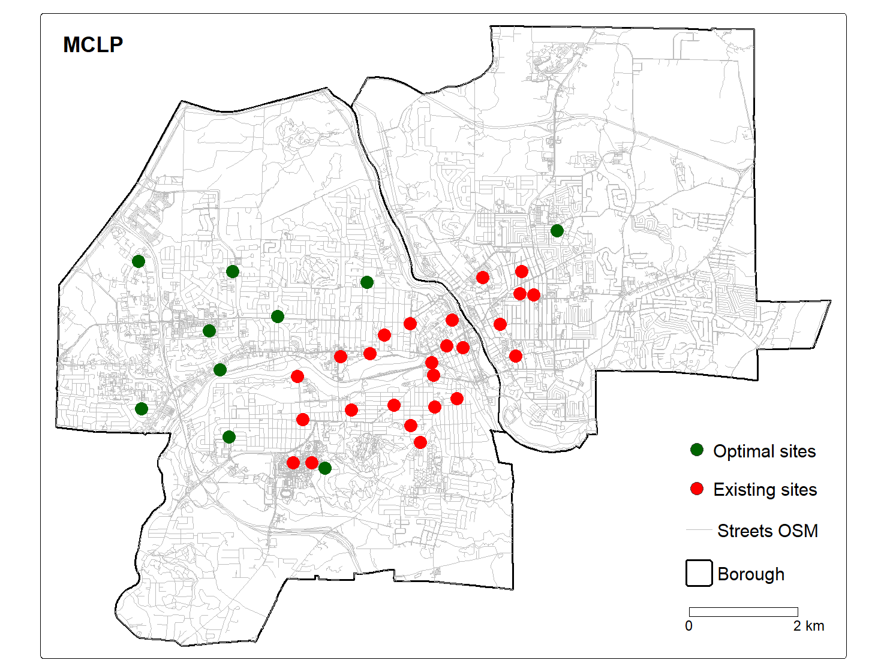

This vignette describes how to use the MCLP function in `localalloc` that can help to maximize the covered demand given a fixed number of facilities and a distance/time threshold.

# Application of the MCLP model with the addition of Bixi stations

## Installation
Make sure first you have install the `localalloc` package.
```{r setup}
pak::pkg_install("sfoucher/localalloc")
library(localalloc)
```

## Bixi dataset
As an example, we read the Bixi dataset available in the `localalloc` package: 

* bixi_candidates : Indicate possible locations for Bixi stations (sf POINT)
```{r, echo=FALSE, eval=TRUE}
library(sf)
head(bixi_candidates)
```
* bixi_demand : Indicate the locations of people likely to use Bixi bikes. (sf POINT)
```{r, echo=FALSE, eval=TRUE}
head(bixi_demand)
```
* bixi_existing :  Indicate the existing Bixi stations (sf POINT)
```{r, echo=FALSE, eval=TRUE}
head(bixi_existing)
```
* bixi_od_candidates : Indicate candidates' origin-destination matrix. It is a long OD table demand-to-candidate (data.frame)
```{r, echo=FALSE, eval=TRUE}
head(bixi_od_candidates)
```
* bixi_od_existing : Indicate existing Bixi stations' origin-destination matrix. It is a long OD table demand-to-existing-stations (data.frame)
```{r, echo=FALSE, eval=TRUE}
head(bixi_od_existing)
```

## Using mclp
The function has 18 arguments in total, but 11 are optional. Some of them have a argument by default (so it is important to check if they make sense with your dataset) and the rest is due to the existing sites who are not mandatory. The exemple below takes into account existing Bixi stations:
```{r}
mclp_highs <- mclp(
  demand = bixi_demand,
  demand_id = "id",
  demand_weight = "weight", # (optional)
  candidate = bixi_candidates, 
  candidate_id = "id", 
  existing_sites = bixi_existing,# (optional)
  existing_sites_id = "id", # (optional)
  matrix_OD_candidates = bixi_od_candidates, 
  matrix_OD_candidates_from_id = "from_id", # (optional)
  matrix_OD_candidates_to_id = "to_id", # (optional)
  matrix_OD_candidates_dist = "travel_time_p50", # (optional)
  matrix_OD_existing_site = bixi_od_existing, # (optional)
  matrix_OD_existing_site_from_id = "from_id", # (optional)
  matrix_OD_existing_site_to_id = "to_id", # (optional)
  matrix_OD_existing_site_dist = "travel_time_p50", # (optional)
  service_radius = 10,
  p_facilities = 35, 
  solver = "highs" # (optional)
)
```
The result is an object of class `localalloc_result`. Its `sf_selected` layer lists every open facility -- the selected candidates and the forced-open `existing_sites` -- with a `source` column (`"candidate"` / `"existing"`) telling them apart:
```{r}
head(mclp_highs$sf_selected)

```
The covered demand is the sum of the weights of the covered demand points:
```{r}
print(mclp_highs$covered_demand)
```
You can also create a map for better visualization with `tmap`:
```{r, echo=TRUE, eval=FALSE}
library(tmap)
library(dplyr)
# Filter selected
sf_selected_candidates <- filter(mclp_highs$sf_selected, source == "candidate")
sf_selected_existing_sites <- filter(mclp_highs$sf_selected, source == "existing")
# Map
tm_shape(FleurNationsArr) +
  tm_borders(col = "black", lwd = 2) +
tm_shape(Rues_zone) +
  tm_lines(col = "gray", lwd = .01) +
tm_shape(sf_selected_candidates) +
  tm_dots(fill = "darkgreen", size = .8) +
tm_shape(sf_selected_existing_sites) +
  tm_dots(fill = "red", size = .8) +
tm_add_legend(
  type = "symbols",
  labels = "Optimal sites",
  fill = "darkgreen",
  size = .8,
  text.size = 1,
  position = tm_pos_in("right", "bottom"),
  frame = FALSE) +
tm_add_legend(
  type = "symbols",
  labels = "Existing sites",
  fill = "red",
  size = .8,
  text.size = 1,
  position = tm_pos_in("right", "bottom"),
  frame = FALSE) +
tm_add_legend(
  type   = "lines",
  labels = "Streets OSM",
  col    = "gray",
  lwd    = 1,
  position = tm_pos_in("right", "bottom"),
  text.size = 1,
  frame = FALSE) +
tm_add_legend(
  type   = "polygons",
  labels = "Borough",
  col    = "black",
  fill   = "white",
  lwd    = 2,
  position = tm_pos_in("right", "bottom"),
  text.size = 1,
  frame = FALSE)  +
tm_scalebar(breaks   = c(0, 2),
            position = tm_pos_in("right", "bottom"),
            text.size = .8) +
tm_title_in("MCLP",
            size = 1.2,
            position = tm_pos_in("left", "top"),
            fontface = "bold")
```
```{r, echo=FALSE, out.width = "80%", out.height="80%",fig.align='center'}
library(knitr)

```
